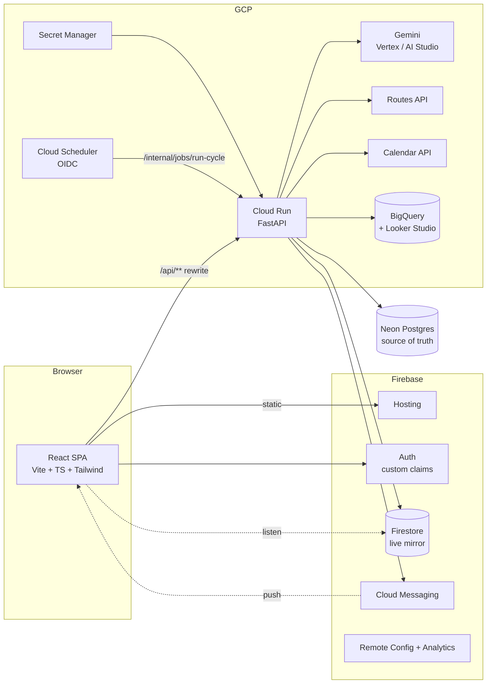

# RaktSetu - Architecture and Agent Handoff

> **Read this first.** This file is the single source of truth for how RaktSetu is built, why, and
> where everything lives. It is written so that any engineer or coding agent (Claude Code,
> Antigravity, Cursor, Copilot, etc.) can continue the work without the original conversation.
> Keep it updated when you change architecture, invariants or deployment.

Last updated: 2026-11-26 · Status: **all P0 and P1 features built and tested locally; P2 partially built; not yet deployed** (see section 16).

---

## 1. What RaktSetu is

RaktSetu ("blood bridge") is a network-level intelligence layer over hospitals and blood banks. It:

1. **Predicts** demand per facility x blood group x component (quantiles + mean) and turns it into a
   **probabilistic time-to-stockout** (Monte Carlo, FEFO-aware, lead-time-aware).
2. **Protects against waste**: unit-level expiry tracking, FEFO, "use it or move it" rescue moves.
3. **Coordinates**: a Google OR-Tools MIP matches surplus to deficit under ABO/Rh, shelf-life-on-arrival,
   cold-chain time and donor-safety-stock constraints. Humans approve every transfer.
4. **Explains and acts** via Gemini: grounded copilot (read-only tools + numeric post-check),
   plain-language explanations, donor appeal drafts (Hindi/English), and register-photo OCR.

It is **decision support, not a medical device**. All demo data is **synthetic** (docs/DATA_CARD.md).
The original hackathon blueprint is `RaktSetu_Hackathon_Blueprint.pdf` (provided by the user, not in repo).

## 2. Quick start (local, ~5 minutes)

```bash
make db            # Postgres 16 in Docker on localhost:55432 (user/pass/db = raktsetu)
make install       # backend venv (uv, Python 3.12) + frontend npm ci
make migrate       # Alembic -> head
make seed          # 12 months synthetic history + first full cycle (~40 s)
make replay        # 90-day policy comparison -> Evaluation page (~6 s)
make api           # FastAPI on :8000   (OpenAPI docs: http://localhost:8000/docs)
make web           # Vite on :5173 (proxies /api -> :8000). Click a demo role to log in.
make test          # 127 tests (pure + Postgres-backed). make lint = ruff + tsc
```
No Google credentials are needed locally: every integration degrades gracefully (section 9).

## 3. Stack decision (OPEN QUESTION for the user)

The user pasted three options. The codebase supports **both A and B with no code changes**:

| | **A. Hybrid (no card)** | **B. Full Google (needs billing card)** |
|---|---|---|
| Frontend | Firebase Hosting (Spark) | Firebase Hosting |
| Backend | FastAPI Docker image on Render free tier (`infra/render.yaml`) | Same image on Cloud Run (`infra/deploy.sh`) |
| API routing | SPA calls `VITE_API_BASE` (cross-origin, CORS) | Hosting rewrites `/api/**` to Cloud Run (same origin) |
| Scheduler | GitHub Actions cron + `X-Internal-Token` (`.github/workflows/cycle.yml`) | Cloud Scheduler + Google OIDC (`infra/scheduler.sh`) |
| Gemini | AI Studio key `GEMINI_API_KEY` (free) | Vertex AI via ADC (`GOOGLE_GENAI_USE_VERTEXAI=true`) |
| Maps | Leaflet/OSM fallback unless a Maps key works | Google Maps JS + Routes API |
| Live | Firestore (Spark) | Firestore + FCM push |

**Pending decision:** does the user have a card / UPI mandate Google Cloud billing accepts? If yes -> B.
Keep Gemini, Firebase, OR-Tools, Calendar API and BigQuery sandbox in either option (all free).

## 4. Repository map

```
promptWars/
  CLAUDE.md / AGENTS.md          project rules for coding agents (identical content)
  README.md                      judge-facing overview
  Makefile  .env.example  .gitignore
  backend/
    app/
      main.py                    FastAPI app, JSON logging, error mapping, prod secret guard
      config.py                  pydantic-settings; all env vars; URL normalisation for asyncpg/psycopg2
      deps.py                    auth dependency, Idempotency-Key, idempotent() replay, internal-job auth (OIDC/token)
      security.py                Principal, demo HMAC tokens, Firebase ID token verification, phone hashing
      schemas.py                 Pydantic request models + validation rules (the OpenAPI contract)
      db/models.py               SQLAlchemy models (all tables, CHECK constraints, indexes)
      db/session.py              async engine; disables asyncpg statement cache behind Neon pooler
      domain/                    pure business rules + transactional state changes
        rules.py                 DEFAULT compat + shelf-life config, group mix, severity order
        compat.py                RuleBook (loaded from compat_rules/shelf_life_rules tables)
        ledger.py                THE ONLY writer of blood_units.status; idempotent events; FEFO; recall; expiry sweep
        reservations.py          SELECT ... FOR UPDATE SKIP LOCKED reservations with TTL
        transfers.py             transfer state machine + unit locking, timeouts
        stock.py                 derived stock views (usable counts, expiry profiles, freshness)
        audit.py, errors.py
      ml/
        forecast.py              baselines, Croston, global LightGBM (q10/q50/q90 + Poisson mean), backtest,
                                 model selection, PIT-based conformal width calibration, drivers
        risk_sim.py              Monte Carlo FEFO time-to-stockout (exact vectorised FEFO), severity + hysteresis
        calendar.py              festivals (Google Calendar API + static table), dengue/monsoon index, Open-Meteo
      optimizer/
        allocate.py              OR-Tools SCIP MIP per (group, component) + greedy substitution pass
        routes.py                Routes API computeRouteMatrix (cached) with haversine fallback
      ai/
        gemini_client.py         google-genai client (AI Studio key or Vertex ADC), rate limit + circuit breaker
        tools.py                 read-only, role-scoped copilot tools (allowlist)
        guards.py                numeric post-check, untrusted-text fencing, injection heuristics
        copilot.py               function-calling loop, retry on ungrounded numbers, template fallback
        features.py              explain_transfer, draft_campaign, extract_register (vision), review_rows
      services/
        cycle.py                 hourly job: sweep -> forecast (daily) -> risk -> plan -> alerts -> mirrors; lease lock
        forecasting.py           Panel loading from DB, persist forecasts/backtest
        risk.py                  builds RiskInput per series (stock, forecasts, incoming, staleness, event mode)
        planning.py              runs optimizer on latest risk, persists proposals (supersedes old)
        alerts.py                tiers, dedupe, cooldown, escalation, auto-resolve
        realtime.py              Firestore mirror, FCM push, Brevo email (all optional)
        analytics.py             BigQuery export (sandbox-compatible load job)
        incident.py              mass-casualty what-if
        availability.py          compatibility-aware search
        scope.py                 RBAC scoping helpers (every endpoint uses these)
      sim/generator.py           synthetic ground truth (network, demand process, messiness)
      sim/world.py               demo-only world ticker (issues/donations through the real ledger)
      api/                       routers: meta (health/auth/registry), inventory, risk, transfers, ops
    alembic/versions/            57e97d998339 initial schema; d4d1fa6a565c forecast mean column
    scripts/seed.py              reproducible dataset + first cycle
    scripts/replay_sim.py        90-day policy A vs B evaluation
    scripts/set_claims.py        Firebase Auth demo users + custom claims
    scripts/smoke.py             post-deploy smoke + pre-demo warm-up
    tests/                       pytest (see section 12)
    Dockerfile  requirements*.txt  pyproject.toml (ruff)  pytest.ini  alembic.ini
  frontend/
    src/api/schema.d.ts          GENERATED from FastAPI OpenAPI (npm run gen:api) - do not edit
    src/api/client.ts            fetch wrapper: token, Idempotency-Key on writes, VITE_API_BASE
    src/lib/                     auth (demo + Firebase), firebase (Analytics, Remote Config, FCM),
                                 live (Firestore listener), i18n (en/hi), format (colour-blind palette)
    src/components/              Layout, MapView (Google Maps + deck.gl / Leaflet fallback), ui primitives
    src/pages/                   14 screens (section 11)
    public/firebase-messaging-sw.js  FCM background notifications
  infra/
    firebase.json firestore.rules firestore.indexes.json   Hosting rewrites + read-only Firestore rules
    setup_gcp.sh deploy.sh scheduler.sh cloudbuild.yaml    Option B
    render.yaml                                            Option A
  .github/workflows/ci.yml (tests, build, gitleaks) · cycle.yml (Option A scheduler)
  docs/  ARCHITECTURE.md (this) DATA_CARD.md EDGE_CASES.md EVALUATION.md API_CONTRACT.md DEMO.md DEPLOYMENT.md openapi.json
```

## 5. System architecture



Layers: (1) clients, (2) edge + identity (Hosting, Auth), (3) FastAPI domain services on Cloud Run,
(4) Neon Postgres (single source of truth), (5) intelligence + ops (Scheduler, Gemini, Routes, OR-Tools,
Firestore fan-out, FCM, BigQuery).

### One hourly cycle (`app/services/cycle.py::run_cycle`)
1. Acquire **lease lock** `job_locks.run-cycle` (20 min TTL). Overlapping runs return `skipped`.
2. Housekeeping: `sweep_expired`, `release_expired` reservations, `expire_stale_approvals` (6 h), `close_day`
   (writes explicit zero rows for yesterday for facilities that reported - missing stays missing).
3. If no forecast for today (IST): `run_forecasts` (backtest + train + calibrate + 14-day forecasts, ~30 s).
4. `compute_risk` for every series (~850 series x 2,000 paths, ~3 s) -> `risk_snapshots`.
5. `build_plan` + `persist_plan` (OR-Tools; previous `proposed` rows become `superseded`).
6. Alerts from risk + stale facilities + regional deficits -> `alerts`; mirrored to Firestore; FCM push for high/critical.
7. Stock summaries + change ping to Firestore; optional BigQuery export; `job_runs` row.

## 6. Data model (Postgres; `app/db/models.py`)

Principle: **the ledger is the truth**. `inventory_events` is append-only with unique
`(facility_id, idempotency_key)`. `blood_units.status` is a projection updated **only** by
`domain/ledger.py` / `domain/transfers.py` / `domain/reservations.py` in the same transaction.

| Table | Purpose / key points |
|---|---|
| regions | state -> district hierarchy |
| facilities | registry; `lat/lng` floats (PostGIS optional, see decision log); `last_reported_at` drives freshness; `note` is untrusted text |
| blood_units | one row per unit; status in available/reserved/quarantined/in_transit/issued/expired/discarded; `reservation_id`, `transfer_id` locks |
| inventory_events | ledger; `event_time` vs `ingest_time` (late data); `source` ui/api/ocr/system/seed |
| rejected_entries | invalid submissions kept with reason (Data Quality page) |
| consumption_daily | training data; row present = reported (0 is real zero); `units_scheduled` = thalassemia cohort units |
| scheduled_demand | known recurring demand (no patient identity) |
| demand_forecasts | latest run only (free-tier storage); q10/q50/q90 + `mean` + drivers |
| risk_snapshots | per run; 3-day retention |
| alerts | dedupe_key, lifecycle open/ack/resolved, escalation, below_count for auto-resolve |
| reservations | TTL holds |
| transfer_requests | proposals + lifecycle; `reason_json` powers the "why" drawer and Gemini explanation |
| donors | consent-based, hashed phone, PIN-centroid location, first name only |
| calendar_events | festivals/holidays/incidents |
| audit_log | every human decision |
| idempotency_records | replay store for non-ledger writes (approve, plan, reserve...) |
| compat_rules, shelf_life_rules | clinical config in data, not code |
| job_runs, job_locks, eval_results, app_config | ops, lease lock, backtest/replay results, editable stress-test assumptions |

Migrations: Alembic, autogenerate from models (`alembic revision --autogenerate -m ...`), run against
`DATABASE_URL_DIRECT` (never the pooler). The app uses the pooled URL.

## 7. Core algorithms

### 7.1 Forecasting (`ml/forecast.py`)
- Panel: `y[series, day]` with **NaN for missing days** (silent facility) vs 0 for reported zero.
  Target = issued minus known scheduled units (scheduled demand is added back deterministically).
- Models: `seasonal_naive` (baseline), `moving_avg_28`, `croston_sba` (intermittent), and a **global
  LightGBM** with quantile objectives (0.1/0.5/0.9) **plus a Poisson-objective mean model**. Features are
  computed as of the forecast origin (direct multi-horizon, h=1..14): calendar, festival proximity,
  dengue/monsoon index, rolling means/std/zero-share, trend, component/group/facility attributes,
  scheduled units, history length. Event days are winsorised before training.
- Rolling-origin backtest (4 origins, 14 days apart, LightGBM trained once before the first origin),
  model **selection per series group** (component x density) by mean pinball loss.
- Calibration: per group, choose an interval **width scale** on the first half of origins so that the
  **randomised-PIT coverage** of the negative-binomial predictive distribution is ~80%; report coverage on
  the held-out half. (Inclusive interval coverage over-states on integer counts; shown for transparency.)
- Cold start: shrink toward the cluster mean (same subtype/group/component), widen intervals -> low confidence.
- Current measured numbers: section 13.

### 7.2 Risk engine (`ml/risk_sim.py`) - signature algorithm
- Inputs per series: remaining *usable* hours per unit (life minus component minimum), 7-day q10/q50/q90
  and mean, scheduled units, incoming transfers (arrival hour, life), lead time, event multiplier.
- Daily demand ~ **negative binomial** (mean from the mean model, variance from the 80% width), split into
  hours by an intraday profile; 2,000 paths x 168 h.
- **Exact vectorised FEFO**: with units sorted by expiry, unit k is consumed iff cumulative demand at its
  expiry >= (consumed so far + 1); first stockout = first hour cumulative demand exceeds total consumed.
  O(n + H) per path. Verified against a brute-force hourly oracle with Hypothesis.
- Outputs: P(stockout) at 24/48/72 h and at lead time, time-to-stockout p10/p50, expected wastage, days
  of cover, risk score, severity. **Critical** if P24 >= 0.5 or median TTS <= lead time; hysteresis
  (de-escalate only below 70% of thresholds). Stale facility (>12 h): pessimistic stock deduction.
- Confidence = geometric mean of freshness, interval width, history length and model agreement.
- Fallback when no forecast: trailing-14-day days-of-cover rule (`rule_based`).

### 7.3 Optimizer (`optimizer/allocate.py`)
Per (group, component) MIP solved with OR-Tools SCIP (5 s limit): minimise severity-weighted unmet
deficit + transport minutes + fixed cost per transfer - rescue bonus for near-expiry units - stability
bonus for previously proposed pairs. Constraints: supply = surplus above donor **safety stock**
(max(P90 x horizon, floor)) + units projected to expire anyway; only units with enough **life on arrival**;
ETA <= component **cold-chain limit**; K nearest sources within radius; max transfers in/out; min 2 units
for routine (medium) needs; a facility that is itself at risk never donates. Second pass: greedy
**compatible substitution** only for high/critical needs, never using Rh-negative stock for Rh-positive
patients, always `needs_clinician_approval=true`. Output `reason_json` (destination risk, source safety,
saves shortage/wastage, constraints, alternatives) drives the UI drawer and Gemini explanation.

### 7.4 Alerts (`services/alerts.py`)
Risk high/critical -> alert (medium is visible but silent, alert-fatigue control). Near-expiry warning when
expected wastage >= 3. Data-silent, regional-deficit (no feasible donor). Dedupe key
`kind:facility:group:component`; re-fire only on escalation or after 6 h cooldown; critical unacknowledged
for 30 min escalates; auto-resolve after 2 calm cycles.

### 7.5 Gemini (`ai/`)
Gemini **never computes numbers**. Copilot loop: function calling over 5 read-only, role-scoped tools ->
answer -> `numeric_check` (every number must match tool JSON within rounding; Devanagari digits handled) ->
one corrective retry -> template answer from tool data. Untrusted text (facility notes, OCR) is fenced in
`<untrusted_data>`; tools are an allowlist; writes only via UI with human approval. Explanations use
structured JSON output + numeric check. Donor appeals: eligibility in code, Gemini writes text only,
validated for `{first_name}` placeholder and STOP opt-out. Register OCR: strict JSON schema with per-field
confidence; rows below 0.8 confidence or with issues block commit; never auto-commits.
Circuit breaker (3 failures / 2 min) + 30 calls/min local limit -> template fallbacks.

## 8. API surface (FastAPI; full schema in docs/openapi.json, summary in docs/API_CONTRACT.md)

Health: `GET /healthz`, `GET /readyz` (also under `/api/`). Auth: `POST /api/auth/demo-login`, `GET /api/auth/me`.
Registry: `/api/regions`, `/api/facilities`. Inventory: `POST /api/inventory/events` (Idempotency-Key),
`GET /api/inventory/matrix|expiring|units`, `POST /api/reservations`, `.../{id}/release`.
Risk: `/api/risk`, `/api/kpis`, `/api/map/risk`, `/api/map/heat`, `/api/forecasts/{f}/{g}/{c}`,
`/api/availability/search`. Transfers: `GET /api/transfers`, `POST /api/transfers/plan`, `POST /api/transfers`
(manual request, over-request flag), `POST /api/transfers/{id}/approve|reject|dispatch|receive|cancel`,
`GET /api/transfers/{id}/explain`. Alerts: `GET /api/alerts`, `POST /api/alerts/{id}/ack`, `POST /api/push/subscribe`.
Simulation: `POST /api/simulate/incident`, `GET|PUT /api/simulate/assumptions`. AI: `POST /api/copilot/chat`,
`POST /api/donors/campaign/draft`, `POST /api/register/extract` (multipart), `POST /api/register/commit`.
Evaluation: `GET /api/eval`, `GET /api/data-quality`. Jobs: `POST /internal/jobs/run-cycle`,
`POST /internal/jobs/world-tick` (OIDC or X-Internal-Token), `POST /api/admin/run-cycle` (coordinator).
All writes require `Idempotency-Key` (8-100 chars) and write `audit_log`.

## 9. Google services: where, how, and what happens without them

| Service | Code | Config | Without it |
|---|---|---|---|
| Gemini (AI Studio or Vertex) | `ai/gemini_client.py`, `ai/copilot.py`, `ai/features.py` | `GEMINI_API_KEY` or `GOOGLE_GENAI_USE_VERTEXAI=true` + ADC, `GEMINI_MODEL` | template answers/explanations/messages; OCR returns 503 "enter manually" |
| Firebase Auth | `security.py::verify_firebase_token`, `frontend/src/lib/auth.tsx` | `FIREBASE_PROJECT_ID`, `VITE_FIREBASE_*`, claims via `scripts/set_claims.py` | demo HMAC tokens (AUTH_MODE=both) |
| Firestore | `services/realtime.py`, `frontend/src/lib/live.ts`, `infra/firestore.rules` | `FIRESTORE_ENABLED=true` (+ADC) | TanStack Query polling (20 s) |
| FCM | `realtime.push_alert`, `/api/push/subscribe`, `public/firebase-messaging-sw.js` | `FCM_ENABLED=true`, `VITE_FIREBASE_VAPID_KEY` | in-app alerts only |
| Remote Config + Analytics | `frontend/src/lib/firebase.ts` (feature flags gate stress/OCR/donors/copilot routes) | `VITE_FIREBASE_MEASUREMENT_ID` | default flags all on; no analytics |
| Firebase Hosting | `infra/firebase.json` (`/api/**` -> Cloud Run) | firebase CLI | Vite dev server / any static host |
| Maps JS API + deck.gl | `frontend/src/components/MapView.tsx` (Advanced Markers, deck.gl HeatmapLayer + ArcLayer via GoogleMapsOverlay - Google's own HeatmapLayer was removed May 2026) | `VITE_MAPS_BROWSER_KEY`, `VITE_MAPS_MAP_ID` | Leaflet + OpenStreetMap with same props |
| Routes API | `optimizer/routes.py` (computeRouteMatrix TRAFFIC_AWARE, 30 min cache) | `MAPS_SERVER_KEY` | haversine x 1.35 road factor at 28 km/h + 15 min handling |
| Calendar API | `ml/calendar.py::fetch_google_holidays` | `GOOGLE_CALENDAR_API_KEY` | static festival table (approximate dates) |
| OR-Tools | `optimizer/allocate.py` | none | always on |
| Cloud Run | `backend/Dockerfile`, `infra/deploy.sh` | - | Render (Option A) / local uvicorn |
| Cloud Scheduler | `infra/scheduler.sh`, `deps.internal_auth` (OIDC verified in code) | `INTERNAL_AUDIENCE`, `SCHEDULER_SA_EMAIL` | GitHub Actions cron + `INTERNAL_TOKEN`; manual "Re-run optimizer" |
| Secret Manager | `infra/setup_gcp.sh`, `--set-secrets` in deploy | - | env vars |
| Cloud Build / Artifact Registry | `infra/cloudbuild.yaml` | trigger on repo | GitHub Actions CI |
| BigQuery (+ Looker Studio) | `services/analytics.py` (load job, sandbox-compatible) | `BIGQUERY_DATASET`, ADC | disabled |
| Cloud Logging / Error Reporting | JSON logs from `main.py` | automatic on Cloud Run | stdout |
| Google Fonts | `index.html` (Inter, Noto Sans Devanagari) | - | system fonts |

## 10. Auth and RBAC
Roles: `hospital_user`, `bank_manager` (scoped by `facility_id`), `regional_coordinator` (scoped by
`region_id` subtree), `admin` (all). Every query goes through `services/scope.py`
(`allowed_facilities`, `assert_facility`, `require_role`). Cross-facility reads return 403 or empty.
Availability search returns aggregate counts network-wide (needed for "find O- nearby") but no unit data.
Demo tokens: `demo.<b64 json>.<hmac>`; 12 h expiry; `DEMO_AUTH_SECRET` must be set in prod (startup refuses default).

## 11. Frontend
React 19 + Vite 8 + TypeScript 5.9 (TS 7 lacks the JS API openapi-typescript needs) + Tailwind 4 +
TanStack Query + Recharts. Screens (`src/pages`): Login, CommandCentre (KPIs, ticking countdowns,
resilience), RiskMap (markers, heat, routes, facility panel), Matrix (availability grid + compatibility
search), Expiry (buckets, rescue moves), Forecast (fan chart: actuals, median, expected mean, 80% band,
drivers), Transfers (prioritised proposals, "why" drawer with Gemini explanation + raw reason JSON,
explicit clinician sign-off checkbox for substitutions, lifecycle buttons per role), Alerts (ack, FCM),
Inventory (ledger events), StressTest (click map, sliders, broken series + plan), Copilot (chat, sources),
Donors (appeal drafts), Register (photo -> review table -> commit), Evaluation (backtest, replay, job
history), DataQuality (freshness, rejects, audit). Hindi/English toggle; Okabe-Ito colour-blind palette
with text + shape on every badge; skip link; keyboard-closable drawer; mobile nav.

**Visual system** (inspired by the look of a large public-hospital website, own brand and assets only):
tokens in `src/index.css` `@theme` - plum `#881E5D` / deep plum `#681861`, crimson `#B30F14`, blush
`#F8F5F5` and pink `#F7E9E9` section backgrounds, ink `#353535`, body `#4F4F4F`, blue gradient hero.
Type: Source Sans 3 (bold, tight tracking) + Newsreader light serif accent line (`<span class="accent">`
inside page `<h1>`, `SectionTitle` component). Layout (`components/Layout.tsx`): dismissible plum
announcement bar, sticky white two-row header (utility links + pill CTAs Copilot/Stress test; main nav),
magenta-to-red CTA band and blush footer. Components (`components/ui.tsx`): pill buttons with chevrons,
panels with one large rounded corner (`rounded-br-[2rem]`), gradient tiles with `rounded-tr`. Severity
colours remain Okabe-Ito (data), separate from brand colours (chrome).

**Public site (signed out)** - `App.tsx` renders `components/PublicLayout.tsx` with: `pages/Landing.tsx`
(rotating hero carousel with pause control, live snapshot from the unauthenticated aggregate-only
`GET /api/public/summary`, role cards, network split section, how-it-works steps, capability tiles,
measured results, latest articles, responsible-AI principles), `pages/Articles.tsx` (category filter,
featured article) and `pages/ArticlePage.tsx` (`/articles/:slug`), and `pages/Login.tsx` (`/login?role=`
pre-selects a demo role). Any other path redirects to `/login`. Article content lives in
`src/content/articles.ts` (8 articles; plain data, CMS-ready). Photos are replaced by original SVG
illustrations in `components/Art.tsx`. Signed-in users can also read articles inside the app.

## 12. Testing (`backend/tests`, 127 tests, ~4 s)
- `test_risk_sim.py`: vectorised FEFO == brute-force oracle (Hypothesis); more stock never raises risk;
  longer lead never lowers it; mean (not median) drives demand; hysteresis; fallback; confidence.
- `test_compat_optimizer.py`: full 8x8 RBC matrix vs blueprint; plasma reversal; O- ordering; donor floor
  never breached (Hypothesis); all-short partial plan; cold-chain and platelet-life rejections; stability;
  at-risk facility never donates; substitutes need clinician + conserve Rh-; rescue; 300 facilities in budget.
- `test_forecast_guards.py`: sparse non-negative, missing != zero, cold start, PIT ~80%, moving festivals,
  numeric check (incl. Hindi digits), fencing, injection detector.
- `test_db_ledger.py` (Postgres): 5x duplicate -> 1 event; concurrent duplicate keys; **50 parallel
  reservations for 10 units -> exactly 10**; TTL release; impossible values -> 422 + rejected_entries;
  11 h vs 13 h platelets; quarantine/reserved exclusion; recall blocks sibling components cross-facility;
  FEFO issue; back-dated event; cross-facility write 403; missing Idempotency-Key 422.
- `test_db_workflows.py` (Postgres): full lifecycle updates both inventories + audit; cancel releases;
  invalid transition 409; substitution needs clinician ack; hospital cannot approve; life-on-arrival blocks
  approval; idempotent approval replay; RBAC scoping incl. district coordinator; bad token; alert
  dedupe/escalation/auto-resolve; lease lock; copilot template fallback; tool allowlist + fenced notes;
  over-request flag; health.
DB tests use `TEST_DATABASE_URL` (default `raktsetu_test` on the local container; CI uses a service container).
UI acceptance: a Playwright script (not committed; see docs/DEMO.md) visits all 14 pages, opens the drawer,
runs the stress test and copilot; 0 console errors at last run.

## 13. Current measured results (synthetic data; regenerate with `make seed && make replay`)
- Forecast (held-out rolling origin, 14-day horizon, 992 series): WAPE **0.738 vs 1.051** seasonal-naive
  (**-29.8%**); median pinball 0.227 vs 0.324; 80% PIT coverage **0.803** calibrated (raw 0.792);
  mean model bias **+20%** on the held-out window (dengue-season decline; honest limitation).
- Replay, 90 days, common random numbers, RBC + platelets: wastage **3,773 -> 2,229 (-40.9%)**, unmet units
  **5,082 -> 2,937 (-42.2%)**, stockout series-days -23.7%, fulfilment 88.9% -> 93.6%, alerts 15,785 -> 2,080
  (7.6x fewer). 48 h alert recall is **lower** (0.71 -> 0.17): remaining stockouts are rare-group bursts. Reported, not hidden.
- Cycle: forecast ~30 s (daily), risk ~3 s, full cycle ~35 s locally. API p95 well under 50 ms warm locally.

## 14. Invariants (do not break)
1. Only `domain/ledger.py`, `domain/transfers.py`, `domain/reservations.py` change `blood_units.status`, always with an `inventory_events` row in the same transaction.
2. Every write endpoint: `Idempotency-Key` + `audit_log`. Use `deps.idempotent()` for non-ledger writes.
3. No automatic substitution; substitutes carry `needs_clinician_approval` and approval requires `clinician_ack`.
4. Gemini output containing numbers must pass `guards.numeric_check`; every Gemini feature has a fallback.
5. Every query is scoped via `services/scope.py`.
6. UTC in DB; Asia/Kolkata for business dates (`ledger.IST`, `forecasting.today_ist`) and UI display.
7. App uses pooled `DATABASE_URL`; migrations use `DATABASE_URL_DIRECT`. No session-level advisory locks or LISTEN/NOTIFY (Neon pooler).
8. Clinical parameters live in `compat_rules` / `shelf_life_rules` (defaults in `domain/rules.py`).
9. Regenerate `frontend/src/api/schema.d.ts` (`npm run gen:api` with the API running) after changing request models.

## 15. Decision log (deviations from the blueprint and why)
- **PostGIS optional**: lat/lng floats + haversine (31 facilities) so the same schema runs on Neon, local Docker and CI without extensions. Add a `geography` column + GiST index if facilities grow past ~1,000.
- **Lease lock instead of advisory lock**: session advisory locks are unsafe through Neon's transaction-mode pooler.
- **Mean model added**: centring the risk distribution on the median under-stated risk for intermittent series (median 0.3 vs mean 0.85 for O- at a large hospital).
- **PIT coverage**: inclusive interval coverage cannot hit 80% on zero-heavy counts; randomised PIT is the standard check.
- **Medium risk does not alert** and substitutions only for high/critical: alert/clinician fatigue.
- **O- emergency uplift in the generator**: O- usage exceeds its 2.5% population share because it is released un-crossmatched.
- **Firestore `/events` world-readable**: data-free change pings so demo-token sessions also get live refresh; alerts and stock summaries stay claim-scoped.
- **TypeScript 5.9 pinned** (TS 7 native compiler has no JS API).

## 16. Status vs blueprint and next steps
Done: all P0 (registry/RBAC, ledger + idempotency, live dashboard + matrix, quantile forecasting, Monte Carlo
risk, map + heat, alerts, expiry/FEFO + rescue, OR-Tools optimizer + lifecycle), P1 (copilot, stress test,
replay + evaluation, thalassemia layer, donor drafts), P2 partial (register OCR, FCM, Hindi toggle, PWA manifest).
Not done / next:
1. **Deploy** (needs the stack decision in section 3, Neon project, Firebase project). Then `scripts/smoke.py <url>`.
2. TimesFM ensemble member (P2, skipped). PWA offline queue (manifest only, no service-worker queue).
3. Facility merge/close workflow endpoint (soft-delete columns exist; no API).
4. Live Open-Meteo rainfall is fetched by helper but not yet wired into features (seasonal curve used).
5. Antigravity browser-agent screenshots for the submission (any Playwright run works too).
6. Re-verify before demo: Gemini model IDs, Maps pricing, Neon/Vertex regions, hackathon rules.

## 17. Gotchas
- SQLAlchemy 2.1 maps `postgresql://` to psycopg3; `config.sync_database_url_direct` forces `+psycopg2`.
- asyncpg needs `ssl=require` (not `sslmode`) and `statement_cache_size=0` behind the Neon pooler (handled in `config._to_async` / `db/session.py`).
- After UPDATE with `onupdate` columns, `await session.refresh(obj)` before serialising (MissingGreenlet otherwise).
- `pkill -f uvicorn` from a shell whose command line contains "uvicorn" kills that shell; use `kill $(lsof -t -i:8000)`.
- LightGBM needs `libgomp1` in the container (Dockerfile installs it).
